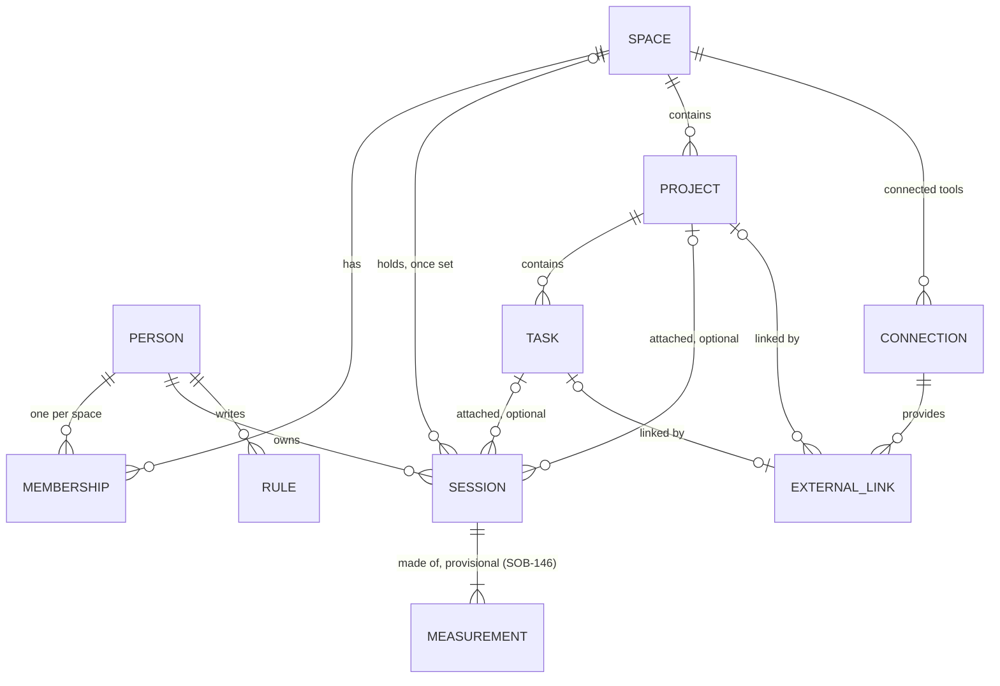

# ADR-0022 — Organization, project, task and session model

- **Status**: Accepted (2026-10-31). Thibault took every recommendation in
  SOB-151, and option 1 of SOB-148 for the project-level k rule.
- **Date**: 2026-10-31
- **Deciders**: Thibault (decision); CTO recommendation
- **Technical context**: Data model and sessions project (SOB-143)
- **Related**: ADR-0003 (SQLite), ADR-0009 (medallion), ADR-0013 (pairing,
  team mode), ADR-0014 (cloud, personal space), ADR-0015 and ADR-0016
  (privacy, visibility), ADR-0019 (repos), ADR-0021 (one app)

> **Summary.** Every measured use of an AI tool ends up in one **session**.
> A session always belongs to one **person** and, once its space is known, to
> one **space**: the person's personal space or an **organization**. Inside
> a space, a session can be attached to a **project**, and to a **task** of
> that project. Both are optional, and a session with neither waits in "to
> classify". Projects and tasks are made by hand, or linked to Linear, GitHub
> or another tracker through one generic **external link**. In **solo mode**
> a space has one hidden project. Only the person attaches their own
> sessions; others see daily totals, never single sessions. Each space has
> its own database and its own member IDs, on the device and on the server.
> The desktop app and the server share the model through one Rust crate.
> Every client uploads through one contract that carries random IDs, the
> source, the model, the day and the metrics, never text and never a clock
> time. The server refuses any other field. Session history starts fresh.
> A personal space can sync between machines through the Sobr server
> (ADR-0013 and ADR-0014, Amendment 2).

## Points decided

Thibault answered these seven points on October 31 in the Decision issue
SOB-151, and took the recommendation of each point (the letters there are
SOB-151's, not those of the option tables below). Each
choice rests on the matching part of the Decision section, which compares
the options with their cost, effort and risk.

1. **A session's space is set by the account used, then can only move down**
   (§3). A person with one space has nothing to choose. A person can
   withdraw one of their sessions from an organization to their personal
   space, and the organization sees only a monthly count. Nothing ever
   moves up. Chosen. Alternatives: no move at all, so a misfiled
   session stays with the organization for 24 months; or free moves both
   ways.
2. **Only the person attaches their own sessions** (§5). Whoever may edit a
   project links it to repos and trackers, which the members' devices use
   to classify. Nobody sees another person's single sessions. Chosen,
   because ADR-0015 rule 4 forbids any view of others finer than the day.
   Alternative: let some roles edit members' sessions, which needs an
   amendment of ADR-0015 and a separate opt-in from each member.
3. **A task always belongs to one project** (§4). Chosen, so task
   totals add up to project totals. Alternative: tasks outside any project.
4. **Solo mode is one hidden project** (§7). Chosen, so switching
   it on or off moves nothing. Alternative: no project at all in solo mode.
5. **One database per space, and one member ID per space** (§2).
   Chosen, on the device and on the server, so no query on use
   data can join a personal space to an organization. Alternative: one
   shared database with a space column on every row.
6. **One upload contract for every client** (§10). The app, the extension
   and later VS Code upload the day of a session, never its clock times, and
   only the allowed fields; the server refuses any other field. The day is a
   calendar day in the space's time zone. Uploads and tracker lookups leave
   in one batch a day, so their timing reveals no hour either. Every client
   applies the space rule of §3, and the extension sends each estimate to
   one place only. Chosen. Alternatives: exact times on the server;
   uploads as soon as a session ends; whole records stripped on the server.
7. **Everything starts fresh** (§11). The new model starts empty on the
   device and on the server. The old stores stay as they are, readable and
   exportable, and app preferences and pairings stay where they are.
   Chosen, because nothing has been published (ADR-0020), so
   conversion code would serve only test data. Alternatives: carry over
   settings and consent, or migrate every old estimate.

## Amendment 1 — Sessions and measurements, settled by ADR-0025 (2026-10-31)

**Status.** Proposed with ADR-0025 (SOB-146); in force when ADR-0025 is Accepted. Written in place by PR (SOB-87): the original text is kept, and notes mark the passages that change.

**What changes.**

1. The tie between a session and its measurements is no longer provisional. A source's report for a session and a day, with a row per model, replaces its previous report whole. The numbers of a session come whole from the most precise source that has numbers, and the other reports stay as history and context.
2. The upload contract of section 10 gains one item: a session merge, carrying the retired session ID and the surviving one. Source references (the IDs that each source gives a session) are local context and never leave the device.
3. Billing reports are not measurements. The server stores a billed figure per space, model and day, shown beside the totals, outside the upload contract.
4. The server needs no finer time than the day to match billing with sessions. The consequence that reserved this question for SOB-146 is closed.

**Why.** ADR-0022 left these points to SOB-146. ADR-0025 decides them, so the references to a decision still to come would otherwise stay open.

**Issues.** SOB-146, SOB-87 (amendment by PR).

## Context and problem statement

Several sources will report AI use: billing, Claude Code, the browser
extension, and later others. Linear and GitHub add context: projects,
issues, repos. Every screen of the Sessions section (T1 to T3), the VS Code
tab (V1 to V4), the project pages (P1, P2) and the connected tools (Z2) needs
one answer to "where does this use belong?". The decisions of October 30 in
[Routes, screen by screen](https://claude.ai/artifact/Cua7SK84VzMCwYFZRQfUHD)
(sections "Modèle" and "Décisions") set the outline:

- **Levels.** Organization (the Sobr workspace, cloud or self-hosted),
  project, task, session. "A project and a task are optional; a session
  always belongs to a person, and Linear is only one source among others."
- **Projects and tasks.** A project is linked to a Linear project or a GitHub
  repo, or created by hand. A task is linked to a Linear issue, or created by
  hand (for example, to debug an error) and linked to Linear later (V3, V4).
- **Attaching.** Triage attaches a session from a task ID, a folder or repo,
  learned rules or the model; otherwise the session is "to classify" (T2). A
  correction can become a rule applied to past sessions (T3).
- **Solo mode.** "This workspace = one project"; the project layer disappears
  from the interface.
- **Teams without Linear.** Another integration, or projects and tasks
  created by hand. V1 covers Claude, Linear, GitHub and manual entry.
- **Two spaces.** A member has a personal space and an organization space in
  the same app, the extension and VS Code, with a switcher (A7). "The Claude
  account used chooses the space of a session", and "the personal space
  never goes up to the organization". A member signs in from the app or the
  extension (M2).
- **Personal data.** Session detail is kept 24 months, then only aggregates.
  When a member leaves, their work use stays in anonymized form. Their name
  and the detail are deleted, after they can export them.
- **Visibility.** ADR-0016 stays as it is: anonymous, opt-in (default) or
  identified with a works council attestation, k-anonymity on aggregates,
  and no view of others finer than the day (ADR-0015 rule 4). Personal use
  always stays private.

### What the code stores today

None of these stores holds prompt text or a prompt hash. The extension reads
the prompt in memory only, to count tokens. No store has a session, task,
space or organization entity.

| Where | Store | One row is |
|--|--|--|
| Desktop, `audit.sqlite` | `audit_entries` (hash-chained, `sobria-audit`; a purge replaces the content with `PURGED`) | One estimate made in the app or by a batch CSV; the personal dashboard adds these up |
| Desktop, `referentiel.sqlite` in the app data folder (user data only; the pipeline's Gold file of the same name lives in `data/gold/`, ADR-0009) | `extension_events` | One estimate from the paired browser extension |
| Same file | `projects` | A named date range over the ledger, with tags; no link to estimates |
| Same file | `personal_goals`, `app_preferences`, `device_pairings`, `team_settings` | A budget cap, a preference, a paired browser, the team connection and its tokens |
| Bridge | `~/.sobria/spool/incoming.jsonl` | One extension estimate received while the app was closed |
| Organization server, `team.sqlite` (schema v4) | `config` | Server settings: JWT key, `visibility_policy`, `visibility_attestation`, `k_anonymity_min`, `retention_days`, mail |
| Same file | `admins`, `users`, `enrollment_codes`, `tokens` | An admin login; an enrolled **device** (one fingerprint each, with its `share_identified` choice); an enrollment code; a refresh token |
| Same file | `estimations` (with a free-text `project` since v4), `alert_thresholds`, `alert_triggers` | One estimate with its exact time; a budget alert on a user or on the whole team; one alert that fired |
| Extension, `chrome.storage.local` | `daily_*`, `session_log`, `last_estimate` | Its own daily totals, its last 50 estimates, its last estimate |
| Same | `sobria_projects_list`, `sobria_thread_projects`, `team_*`, `pairing_state` | Free-text project labels and a label per conversation URL; its own server enrollment; its pairing with the app |

Four facts shape the design:

- **The extension uploads on its own.** In `team` mode it posts each
  estimate straight to the server; in `both` mode it also sends it to the
  app, so the same use is counted twice (SOB-118).
- **The server knows devices, not people, and no organization.** One server
  is one implicit team, and a person with two enrolled devices counts as
  two users, including for k-anonymity.
- **Some server views ignore the policy today.** The CSV and PROV-O exports
  list single estimations with their exact time and device, and per-user
  alerts check no policy (SOB-114, SOB-115).
- **The desktop stores have no schema version.** Each runs `CREATE TABLE IF
  NOT EXISTS` and patches columns by hand.

### What is out of scope

- How reports from several sources form one session, and duplicates across
  sources: SOB-146, which this ADR blocks.
  > Amendment 1 (2026-10-31): settled by ADR-0025.
- The sources themselves (what each captures, which account it can see,
  and whether an estimate made in the Understand pages counts as use), and
  screen design.
- The list of roles and what each may do, beyond the two limits of §5: the
  Organization and identity project (ADR-0021, point 4), as is the identity
  source (SSO, SCIM).
- When the personal space's sync between machines ships, and the limits of
  the free personal space. ADR-0013 and ADR-0014 (Amendment 2, SOB-136)
  allow a free personal space on the Sobr server that syncs between a
  person's machines, and leave both points open; SOB-103 owns the dates.

## Decision

### 1. Entities

> Amendment 1 (2026-10-31): the tie between a session and its measurements is no longer provisional. See ADR-0025.

| Entity | What it is | Owner | Required | Optional | Where it lives |
|--|--|--|--|--|--|
| Person | Someone who uses Sobr: the guest of one install, or a Sobr account | Themself | — | Their accounts in the sources (Claude, Linear, GitHub), each mapped to one of their spaces | Their devices; only the device and the accounts database know all of a person's memberships |
| Space | A container for projects and sessions, of kind *personal* or *organization* | Personal: its person. Organization: the organization, run by its admins | Kind, name | Solo mode; for an organization, its visibility policy, k and retention (ADR-0015, ADR-0016) | One database of its own (§2) |
| Organization | A space of kind *organization*: the Sobr workspace, in the cloud or self-hosted | Its admins | At least one admin | Connections, budgets | Its server |
| Membership | A person inside one space: an ID that exists only in that space, and a role | The space | Space, member ID, role | Projects the member works on; their sharing choice (ADR-0015) | That space's database |
| Project | A unit of work in one space | Its space | Space, name | External links (tracker project, repo), dates, budget, who may edit it | Its space's database |
| Task | A piece of work in one project | Its project | Project, title | One external link (an issue); at most one task per issue in a space | Its space's database |
| Session | One continuous use of an AI tool by one person, such as a Claude Code session or a browser conversation | Its person; inside a space, through their member ID | Person, source, start time (on the device; the server keeps only the day, §10), state (§4) | Space (required before it leaves the device); project, which must be in the session's space; task, whose project must be the session's project; end time | A pending store on the device while its space is pending; then its space's database, and its space's server when that space is an organization |
| Measurement | One report from a source, such as a turn or an estimate, with its metrics | Its session | Session, source, time (on the device; the server keeps only the day, §10), metrics, method | — | With its session |
| Connection | A tool account connected to a space (Z2): Claude, Linear, GitHub | Its space | Space, provider | — | Its space's database |
| External link | The tie between a project or task and its counterpart in a tool | Its project or task | Connection, external ID | URL | Its space's database |
| Rule | An attachment rule from a correction (T3), such as "sessions in this repo go to this project" | The person who made it | Condition, target | — | That person's device |

A session's totals come from its measurements. The tie between a session
and its measurements is provisional: SOB-146 decides how reports from
several sources form one session, which may change it. Billing reports,
which cover a workspace or a key per day rather than one person's use, are
left to SOB-146.

> Amendment 1 (2026-10-31): ADR-0025 settles both. Billing is not a measurement.

### 2. Spaces, members and storage

**One database per space.** A space keeps its projects, tasks, memberships,
connections and sessions in a database of its own, on every machine that
holds it:

- the device holds one file for the personal space, one file per
  organization the person belongs to with only that person's part, and one
  pending store for sessions whose space is not set yet;
- the server holds one file per organization space, plus an accounts
  database for sign-in;
- a self-hosted server has one organization space, and the Sobr cloud has
  many (ADR-0014).

**One member ID per space.** A person has a different ID in each space.
Uploads carry the ID of the space they go to. Only the person's device and
the accounts database link a person's IDs across spaces, and the accounts
database holds no use data.

Budgets (B2) attach to a member, a project or a space, as decided on October
30. Their thresholds and alerts are not part of this ADR, except the
visibility limit of §10.

| Option | Cost | Effort | Risk |
|--|--|--|--|
| **A — One database and one member ID per space (chosen)** | Many small files on a cloud server; schema migrations run per file | Medium | Low: deleting a space deletes a file, and no query on use data can reach another space |
| B — One shared database, a space ID on every row, one person ID everywhere | One file to back up and migrate | Small | One missing filter leaks one organization's data to another, or joins a personal space to an organization through the shared person ID |

### 3. The space of a session

**The account used sets the space,** as decided on October 30. The person
maps each of their source accounts to one space once: for example, their
work Claude account to the organization and their own account to the
personal space. A person with only one space has nothing to map: every
session goes to it. A session whose source gives no account is *space
pending*. It stays in the device's pending store, and nothing is sent until
the person picks a space: in T2 in the app ("au perso" picks the personal
space), or in the extension's popup for a member who uses the extension
alone (M2).

**Every client applies this rule,** the extension included, because a
member can use the extension alone (M2). The model crate publishes test
cases that each client must pass.

**A space can only change downwards.** A person can withdraw their own
session from an organization to their personal space, for example when an
account was mapped to the wrong space. This is possible as long as the
server keeps that session's detail (24 months, §10). The server deletes it.
In the personal space its attachment resets to "to classify", because the
organization's projects and tasks do not exist there. The organization sees
only the number of sessions withdrawn each month, and only in months when
at least k members were active, with no name and no detail. A session
never moves from the personal space to an organization.

| Option | Cost | Effort | Risk |
|--|--|--|--|
| A — The space never changes once set | A session misfiled by a wrong mapping stays with the organization for 24 months | Small | Personal use filed by mistake stays visible to the organization, against "personal use always stays private" and the right to correction |
| **B — One-way withdrawal from an organization to the personal space, counted (chosen)** | Organization totals can drop after the fact | Small | Work use can be hidden; the monthly count shows when that happens |
| C — Free moves both ways | Every move needs an upload or a delete, and a trace | Medium | Personal use pushed up by mistake, against "never goes up" |

| Option | Cost | Effort | Risk |
|--|--|--|--|
| **A — Every client applies the space rule, with shared test cases (chosen)** | The rule is written in Rust and in TypeScript | Medium | Low, with the shared test cases |
| B — The extension uploads only through the desktop app | Members without the desktop app cannot report browser use, against M2 | Small | Members install the app only to report, or stop reporting |

### 4. Projects, tasks and attaching sessions

**Invariants:**

- a project belongs to one space, and a task to one project;
- a session's project is in the session's space, and when a session has a
  task, its project is the task's project;
- a session has at most one project and one task, and it is not split
  across tasks.

**States.** A session is in one of three states:

- *space pending*: no space yet, so it stays in the device's pending store
  (§3);
- *to classify*: it has a space but no decision about its project;
- *classified*: attached to a project, to a project and a task, or marked as
  having no project.

A session with no project counts in its space's total, under "no project".

**Attachment record.** Each attachment records what made it: the source (a
task ID found in a branch name), a project link (§5), a rule (§6), solo mode
(§7), or the person.

**Tracking per task.** Task totals are the sum of the sessions attached to
the task. A project's total is the sum of its sessions, including those with
no task, which show as "no task" on P2. What others may see of those totals
is in §10.

| Option | Cost | Effort | Risk |
|--|--|--|--|
| **A — A task always belongs to one project (chosen)** | An issue from a tracker project that no Sobr project links waits until someone links that project | Small | Low: totals always add up from task to project to space |
| B — A task can exist outside any project | Two kinds of task to show and to add up | Medium | Totals that do not add up across levels |

| Option | Cost | Effort | Risk |
|--|--|--|--|
| **A — "To classify" is a state, and project and task are optional links (chosen)** | Every query must handle sessions with no project | Small | Low |
| B — Each space has a hidden "Inbox" project that holds unclassified sessions | One fake project in every list and total | Small | The fake project leaks into reports and exports |

| Option | Cost | Effort | Risk |
|--|--|--|--|
| **A — A session goes to one task, whole (chosen)** | A session that covered two tasks is counted on one | Small | Low: one wrong task at most, fixed by the person |
| B — A session can be split across tasks by shares | Shares to enter, store and add up | Large | Made-up precision: nobody knows the true split |

| Option | Cost | Effort | Risk |
|--|--|--|--|
| **A — "No project" is allowed in every space (chosen)** | Organization use with no project shows only in the organization total | Small | Low |
| B — "No project" only in the personal space; organization sessions must get a project | Organizations must keep a catch-all project | Small | Fake catch-all projects, and an inbox that never empties |

### 5. Who attaches what

**Only the person attaches their own sessions** (T2, T3), in any space.

**Whoever may edit a project works at project level** (P2):

- they link it to tracker projects and repos;
- they create its tasks by hand.

Which roles may edit a project is for the Organization and identity project
(ADR-0021, point 4). The links reach the members' devices, which use them to
classify: a session in a repo whose remote matches a project's linked repo
goes to that project. The match runs on the device, and only the resulting
project ID is uploaded. A repo, and a tracker project, can be linked to at
most one project in a space; a second link is refused, so every client
finds the same project.

**Two limits hold for every role:**

- nobody but the person sees their single sessions or anything finer than
  the day (ADR-0015 rule 4, ADR-0016); others see daily totals under the
  rules of §10;
- nobody but the person changes their session attachments. Two project-level
  acts touch them without choosing for the person: deleting a task or a
  project sends its sessions back to "to classify", and merging two tasks of
  the same project for the same issue (§8) keeps their sessions on the
  merged task, because they were attached to the same work.

| Option | Cost | Effort | Risk |
|--|--|--|--|
| **A — Only the person attaches; project editors act through project links (chosen)** | Nobody else can fix a member's wrong attachment; project links can be fixed, and the member fixes the rest | Medium | Low: keeps ADR-0015 rule 4 |
| B — Some roles edit members' sessions | ADR-0015 must be amended, with a new opt-in from each member that is separate from the sharing choice | Medium | Session-level views of members are what ADR-0015 rules out |
| C — The device and those roles both write, and the last write wins | Clock-based conflict handling | Medium | Silent overwrites, on top of B's problem |

### 6. Rules

A correction in T3 can become a rule: a condition (folder or repo, branch
pattern, source account, model) and a target (project, task, or no project).
The person decides whether it applies to past sessions. Rules live and run
on the person's device, because their conditions use local context that
never leaves it (§10). A VS Code workspace associated with projects (V2) is
a rule on its folder. Project links (§5) are the rules shared across an
organization; other shared rules are left to a later decision.

| Option | Cost | Effort | Risk |
|--|--|--|--|
| **A — Rules live and run on the person's device (chosen)** | A person with two machines writes a rule on each | Small | Low: conditions on folders and branches stay local |
| B — Rules live on the server and run there | Folder, repo and branch names must be uploaded for the server to match them | Medium | Breaks the contract of §10 |

### 7. Solo mode

Solo mode is a setting of a space. A space created in solo mode gets one
project, named like the space and hidden from the interface. Every session
classified after that goes to that project, and tasks are created in it.
Solo mode can be turned on only when the space has at most one project; in
a space with no project, turning it on creates the hidden project.
Switching it on or off changes no existing session: on, it applies to the
sessions classified from then on; off, it shows the project as a normal
one. An organization with a single project can use solo mode too. In solo
mode, the repos and tracker projects linked in the space's settings (Z2) are
the hidden project's links, so trackers work as in any project (§5, §8).

| Option | Cost | Effort | Risk |
|--|--|--|--|
| **A — One hidden project (chosen)** | One project row per solo space | Small | Low: switching modes changes only what the interface shows and where new sessions go |
| B — No project at all; sessions and tasks hang off the space | Tasks need a second parent, and leaving solo mode must create a project and move everything | Medium | Data moves when a setting changes |

### 8. Teams without Linear, and external links

**By hand.** Projects and tasks can always be created by hand, in both kinds
of space.

**Through trackers.** Trackers plug in through **connections** (one per tool
account of the space, Z2) and **external links** (provider, external ID,
URL) on projects and tasks. V1 covers Linear and GitHub, and Jira or Notion
come later.

- **Linking an issue later.** A hand-made task can be linked to an issue
  later (V4). A space holds at most one task per issue. Linking a task to an
  issue that already has a task in the same project merges the two tasks
  (§5). A link that would merge tasks of two different projects is refused:
  the editor moves or deletes one of them first. A hand-made task can only
  be linked to an issue whose tracker project is linked to the task's own
  project, so later sessions keyed to that issue follow the same project.
- **Removing a link** keeps the task and its sessions.
- **Writing to a tracker,** such as creating an issue from V4, happens only
  on an explicit action.

**Tasks from trackers are created on use.** A task that mirrors an issue is
created in Sobr when a project editor creates it, or when a session is
attached to that issue: through a task ID found in a branch name, or
because the person picks the issue in T2 or V4. The device asks the server
only in its daily batch (§10), and never sends the branch name the key came
from:

- **Trackers with keys, such as Linear.** A key found in a branch name
  counts only if it matches the key format of a connected tracker. The
  device sends the key alone, such as `ACM-142`.
- **GitHub.** An issue number has no key format and belongs to its repo, so
  in V1 a number in a branch name creates nothing. A GitHub issue becomes a
  task when the person picks it in T2 or V4. The device then sends the ID
  of the project's repo link, which the server already holds, with the
  issue number.

Until then the session shows under that issue on the device only. Sobr
never mirrors all the issues of a linked project.

**The project of a task created on use** is the project linked to the
issue's tracker project; the task never goes elsewhere. When a session is
attached to one project by a repo link (§5) and its issue key belongs to
another project:

- if the person chose the session's project themself, their choice wins:
  the session keeps its project and gets no task;
- if both attachments are automatic, the issue key wins: the session moves
  to the task's project, with the task;
- if no project links the issue's tracker project, no task is created and
  the session keeps its project.

**A task created on use stays hidden from others,** in the anonymous and
opt-in policies, on every day it has fewer than k contributors (§10 says
how they are counted). Its existence would otherwise tell others
that someone worked on that issue, and the issue's assignee would name that
person. The person always sees their own tasks.

| Option | Cost | Effort | Risk |
|--|--|--|--|
| **A — One generic external link for every tracker (chosen)** | Provider-specific details live in each integration, not in the model | Small | Low: a new tracker adds no table |
| B — One table or column set per tracker | A schema change for every new tracker | Medium, growing with each tracker | The model follows each tool's shape |

| Option | Cost | Effort | Risk |
|--|--|--|--|
| **A — A task mirrors an issue only when an editor creates it or a session uses it, and a task created on use stays hidden from others on any day with fewer than k contributors (chosen)** | A lookup in the tracker when a session is classified, cached; per-task totals appear late on small projects | Small | Low |
| B — Mirror every issue of a linked project | A sync job and stale copies of issues that never get a session | Large | Copies of tracker data that Sobr does not need |

### 9. The same model on the device and on the server

**One crate.** A new Rust crate holds the entities, their invariants, the
upload contract (§10), the test cases of §3, and the SQLite schema of a
space with numbered migrations (`PRAGMA user_version`). Clock-time columns
exist only in the device's tables; the server's tables hold the day in
their place (§10). Both the desktop app
and the organization server use it. It has no Tauri or HTTP dependency, and
it lives in the `sobr` repo with the app and the server (ADR-0019,
ADR-0021). The server adds what only it needs: the accounts database,
memberships, visibility (ADR-0015, ADR-0016) and retention.

**IDs.** Every record gets a random UUID (version 4) where it is born. The
device creates sessions, measurements, rules, and the projects and tasks of
a personal space. The server creates organization projects, tasks and
memberships. Records then move between device and server with no
renumbering, and an ID tells nothing about when its record was created.

**On the desktop,** the model gets new files: one per space, and the pending
store (§2). Today's `referentiel.sqlite`, which holds user data despite its
name, keeps preferences and pairings until the Deep cleanup of the desktop
backend decides their place.

**Who writes what in an organization space:**

- the device creates the person's sessions and measurements, and uploads
  them;
- the server owns projects, tasks, memberships, connections and project
  links;
- the person's attachment changes are requests. The device sends them in its
  daily batch (§10), and keeps them while offline. The server applies them,
  or refuses them when the target project or task is gone, and the device
  then takes the server's state;
- the device keeps only the person's own sessions, plus the projects, tasks
  and links that the person may see. Totals of others are fetched when
  shown, not stored.

**In a personal space,** the device owns everything until the person turns
sync on. ADR-0013 and ADR-0014 (Amendment 2) allow a personal space on the
Sobr server that syncs between the person's machines. With sync on, the
personal space is hosted there and follows the organization rules above:

- the server owns projects, tasks and attachments;
- the server creates tasks from trackers, so two machines never create the
  same one;
- rules still stay on each device.

Two machines that already hold a personal space each must merge them at the
first sync; issue 15 decides how. The model and the upload
contract do not change; the write path of the personal space does.

| Option | Cost | Effort | Risk |
|--|--|--|--|
| **A — One model crate for the app and the server (chosen)** | The crate must build for both; schema changes are reviewed once | Medium, once | Low: one set of invariants and migrations |
| B — Separate models in the app and the server, mapped through an API contract | Two schemas to keep in step | Medium, then again for every change | The two drift, and the same rule is coded twice |

| Option | Cost | Effort | Risk |
|--|--|--|--|
| **A — Random UUIDs (version 4) everywhere (chosen)** | 16-byte keys with no time order, so indexes grow less neatly | Small | Low |
| B — Time-ordered UUIDs (version 7) | Same size, better index order | Small | Each ID carries its creation time to the millisecond, so anyone who sees an ID, including whoever runs a self-hosted database, learns when the session started |
| C — Local integer IDs, plus a mapping table to server IDs | A mapping for every upload and every reference | Medium | Mapping errors attach sessions to the wrong record |

| Option | Cost | Effort | Risk |
|--|--|--|--|
| **A — New files, one per space, plus the pending store (chosen)** | A second set of files next to today's | Small | Low: no hand-made patches on a file without a schema version |
| B — New tables in today's `referentiel.sqlite` | One file | Small | Mixes versioned and unversioned tables, and cannot hold one space per file |

### 10. Privacy

**What leaves a device.** Prompts never leave the device (CLAUDE.md §7,
ADR-0013, ADR-0015). Every client that uploads (the app, the extension and
later VS Code) uses one upload contract, defined once in the model crate.
The app and the server use the crate directly. Other clients keep
hand-written types (ADR-0019, ADR-0021 §2), and a test checks their payloads
against example payloads that the crate exports. The example payloads and
the test cases of §3 are published with each release, as ADR-0019 §3 does
for its shared cases, so a client in another repo, such as the extension,
can run them. The contract holds only:

- for a session: its ID, the member ID, the space ID, the project and task
  IDs, the source kind, the provider host (such as `claude.ai`), the model
  ID, the day it started, the state, and what made the attachment;
- for a measurement: its ID, its session ID, its source, its day, the model
  ID, the input and output tokens, energy, CO₂ and water with their P5, P50
  and P95 values, the cost, and the method with its version;
- for a tracker lookup (§8): the space ID, and either the issue key alone,
  such as `ACM-142`, or, for GitHub, the ID of the project's repo link with
  the issue number;
- for an attachment change: the session ID and the target, which is a
  project ID, a task ID or "no project";
- for a withdrawal (§3): the session ID.

> Amendment 1 (2026-10-31): ADR-0025 adds one item to this list: a session merge, with the retired session ID and the surviving one.

**What never leaves a device:**

- prompt or response text, and anything derived from it, such as a title,
  a summary or a first message;
- clock times (the device keeps them for the person's own views);
- file paths, folder, repo and branch names, and conversation URLs. An issue
  key found in a branch name leaves only on its own, in a lookup;
- command lines;
- rules (§6);
- sessions with a pending space.

**Which day.** A day is a calendar day in the space's time zone. An admin
sets that zone when the organization is created, and a change applies only
to the days that follow. A personal space stores one zone too, set from the
first device and changed by the person, so its synced machines count the
same days. The device computes the day, so daily totals, k counts and
retention all use the same days for every member.

**When it is sent.** Each device sends one batch a day per space, after
that day has ended in the space's time zone, at a random minute. The batch
holds the day's session uploads, tracker lookups (§8), attachment changes
and withdrawals (§3). The lookups go first; the uploads then carry the task
IDs that the lookups returned. The timing of the batch then tells the server and its
logs nothing finer than the day about the use. Other requests, such as
reading totals or refreshing a sign-in, still show when a member opens the
app; they carry no use data. The person's own views on the device are
up to date at once; the organization's totals and new tasks appear the next
day.

**How it is enforced:**

- **On each client,** a test fails when a field is added to the upload type
  without being in this list.
- **On the server,** uploads with any other field are refused. Today's
  estimation upload, with its free-text `project`, is removed: no published
  client uses it (ADR-0020). New uploads use the contract under the
  `/api/v1` prefix (ADR-0019).
- **The extension** sends each estimate to one place only: to the app when
  it is paired, otherwise to the server under the contract, after applying
  §3. Its `both` mode goes away (SOB-118).

The server keeps each session at day grain because the person sees all of
their own use (ADR-0015 rule 1) and can export it when they leave. Whoever
runs a self-hosted server can still read that database directly, as they can
read today's estimations. ADR-0015 governs what the product shows, not what
an operator can read.

**Visibility.** ADR-0015 and ADR-0016 apply on the server to everything that
others see: dashboards, exports, alerts and the API.

- Others see daily totals by project and by task, never single sessions.
  Exports become daily totals under the policy and k (SOB-114).
- **The k check runs day by day.** For each day and each group, k is the
  number of distinct members with at least one measurement in that group
  that day, since daily totals add up measurements. This follows ADR-0015
  rule 2, which counts the users active in a window; here the
  window is always one day. A view over a longer period, such as a month,
  adds up only the day values that passed the check. So a longer view never
  shows more than its days do, and "month minus the days shown" gives
  nothing back. The same daily check applies to tasks created on use (§8).
- An alert on one member's budget is allowed only in the identified policy,
  or when that member has turned sharing on (SOB-115).
- In the anonymous and opt-in policies, a project's breakdown by task
  appears only when every task shown, the remainder ("other tasks") and "no
  task" each have at least k contributors. Empty groups are left out of
  this check. Otherwise the project shows its total only. Merging only the
  small tasks would let anyone subtract them from the total.
- At project level, the same rule applies, as Thibault chose on October 31
  (SOB-148, option 1). A space's breakdown by project appears only when
  every project shown, "other projects" and "no project" each have at least
  k contributors; otherwise only the organization total shows. SOB-153
  amends ADR-0016 to match.
- In practice, under the default policy, per-task totals show only on large
  projects. Each person always sees their own per-task totals.

**Retention and departure,** as decided on October 30:

- the server keeps session and measurement detail for 24 months
  (`retention_days`, 730 by default, ADR-0015);
- after that it keeps only daily totals with no member, each with its number
  of contributors that day, built with the same all-groups rule as the task
  breakdown above, checked day by day, whatever the policy:
  - the space keeps its breakdown by project only when every project kept,
    "other projects" and "no project" each have at least k contributors;
    otherwise it keeps its total only;
  - a project kept in that breakdown keeps its breakdown by task only under
    the same condition at task level; otherwise it keeps its total only;
  - empty groups are left out of the check.

  Nothing kept can then be subtracted down to one person. This is the same
  rule as the live views above;
- when a member leaves, their name and their session detail are deleted
  after they can export them. What stays is one row per day and group with
  their totals, and no member. Each such row counts as one contributor of
  that group that day, and is never shown on its own: it only adds to a
  group that passes the all-groups check with it;
- the device keeps the person's own copy.

These retention and departure rules are for organization spaces. A synced
personal space is the person's own data, under Sobr as controller: the
server deletes it with the account at the latest, and issue 15 sets what it
keeps until then.

| Option | Cost | Effort | Risk |
|--|--|--|--|
| **A — Session rows at day grain; clock times stay on the device (chosen)** | The person's other devices and their export show days, not times | Small | Low, with the daily batch below: no time finer than the day reaches the server, in the fields or in the timing |
| B — Session rows with exact times | None | Small | Times reach the server and its operator, and any view that forgets the day rule shows them |
| C — Only daily totals per member, project, task and model | No session rows on the server | Small | Breaks the October 30 rule on keeping session detail 24 months, and the export at departure |

| Option | Cost | Effort | Risk |
|--|--|--|--|
| **A — One allow-listed contract, checked on each client and on the server (chosen)** | Every new field needs a decision | Small | Low: text cannot leave by accident, and a client that tries is refused |
| B — Send whole records and strip fields on the server | None on the client | Small | Text crosses the network and reaches server logs before it is stripped |

| Option | Cost | Effort | Risk |
|--|--|--|--|
| **A — A task breakdown appears only when every group shown has k contributors (chosen)** | Many projects show no breakdown under the default policy | Small | Low |
| B — Merge only the small tasks into "other tasks" | More breakdowns shown | Small | Subtracting the shown tasks from the project total reveals the small ones |

| Option | Cost | Effort | Risk |
|--|--|--|--|
| **A — The day in the space's time zone, computed on the device (chosen)** | Each space stores a time zone; members far from it see some late sessions on the next day | Small | Low: every member's day is the same day |
| B — The UTC day | None | Small | A European working day splits across two days, so totals and k counts split too |
| C — Each device's own local day | None | Small | Members in different zones count the same hour on different days, and k counts go wrong |

| Option | Cost | Effort | Risk |
|--|--|--|--|
| **A — One batch a day per space, at a random minute after the day ends (chosen)** | Organization totals and new tasks from trackers appear the next day | Small | Low: the timing reveals no hour |
| B — Upload each session when it ends, and look up tasks when classifying | None | Small | The server and its logs see when each session ended, almost to the second |

### 11. Migration

Nothing has been installed by outside users (ADR-0020), so the only data is
development and test data. **Everything starts fresh:**

- the new model starts empty on the device and on the server; nothing is
  converted;
- the old stores stay as they are, read-only, with an export: on the
  desktop `audit_entries`, `extension_events`, `projects`, `personal_goals`
  and `team_settings`; on the server `team.sqlite`; in the extension its
  labels and its own totals;
- the journal and the reports keep reading the old estimates; Home shows
  sessions from the change onwards;
- app preferences and browser pairings are outside the model, and stay where
  they are (ADR-0013);
- a test server is set up again, and its members enroll again;
- the spool is drained before the change, with the secret check that
  ADR-0013 Amendment 1 requires.

| Option | Cost | Effort | Risk |
|--|--|--|--|
| A — Migrate every old estimate into legacy sessions, plus all settings | Conversion code for test data; a fourth session state, "legacy"; devices mapped to people by guesswork | Large | Wrong totals from guessed groupings, and code kept for data nobody outside has |
| B — Start session history fresh, but carry over settings and consent | Conversion code for the settings of test servers | Medium | Low, but it serves only test setups |
| **C — Start everything fresh, and keep the old stores readable and exportable (chosen)** | Test setups are configured again; Home starts empty | Small | Low: nobody outside has data, and nothing is deleted |

## Examples

**Solo, personal space.** Alice uses the app as a guest, in solo mode. She
has one space, "Alice", with one hidden project.

1. A Claude Code session in `~/code/blog` goes to her only space and to its
   hidden project as soon as it starts.
2. She creates the task "Fix the RSS feed" by hand. In T3 she attaches the
   session on branch `fix/rss` to it, and saves the rule "branch `fix/rss*`
   → this task". The rule also attaches two earlier sessions.
3. Home shows her total and the task's total.
4. Nothing leaves her machine. If she turns solo mode off, "Alice" appears as
   a normal project and she can add others.

**Organization.** Acme runs a self-hosted server under the opt-in policy, with
k = 5. Bob is a member. Carol may edit the project "Checkout" and has linked
it to a Linear project and to the GitHub repo `acme/checkout`.

1. Bob maps his work Claude account to Acme and his own account to his
   personal space.
2. A Claude Code session in his clone of `acme/checkout`, on branch
   `bob/acm-142-retry`, matches the project's linked repo. "ACM" is the key
   of Acme's Linear team, so the session shows under ACM-142 on Bob's
   machine at once.
3. The next day, in its daily batch, the device first asks the server for
   ACM-142, which becomes a Sobr task in "Checkout". It then uploads the
   session's IDs, with that task ID, and its model, day and metrics under
   Bob's Acme member ID. The repo, the branch name and the times stay on his
   machine.
4. Carol's project page shows the project's daily totals, on the days when
   Acme's breakdown by project passes the k check (§10). ACM-142 appears
   there only for the days when five people worked on it, and the breakdown
   by task only when every task shown, "other tasks" and "no task" each have
   at least five contributors that day. Carol never sees Bob's single
   sessions.
5. Bob sees he attached a session to the wrong task, and moves it from
   ACM-142 to ACM-150 himself.
6. In the evening, Bob uses his own account. That session goes to his
   personal space and is never sent to Acme.
7. One morning he used his own account for Acme work by mistake. That session
   stays personal; nothing moves up. Had it been the other way round, he
   could withdraw it, and Acme's monthly count of withdrawals would grow by
   one.

## Consequences

**Positive:**

- One model answers every screen that depends on it: T1 to T3, V1 to V4, P1,
  P2 and Z2.
- Linear is not required: projects and tasks can be made by hand, and other
  trackers add no table.
- A personal space and an organization share no database and no ID, on the
  device or the server.
- No text and no clock time leaves a device, and both the clients and the
  server check it.
- Nobody sees another person's single sessions, whatever their role.

**Negative:**

- A new crate, new database files on the device, and a new storage layout
  on the server, all before any screen can use the model.
- Home starts empty after the change, while the journal keeps the old
  estimates.
- Nobody but the person fixes a member's attachments; project links help.
- Under the default policy, breakdowns by project are hidden in small
  organizations, and by task in small projects.
- A past day's total can change when a late batch or a withdrawal arrives.
  Someone who saw both values of that day learns the use that arrived or
  left, when the day passed the k check both times.
- Until the Organization and identity project brings real identities, each
  enrolled device is a member, so a person with two devices counts twice for
  k.
- Whoever runs a self-hosted server can read its database, at day grain.
- SOB-146 may need finer times on the server to match billing with sessions;
  it must weigh that against §10.
  > Amendment 1 (2026-10-31): it does not. ADR-0025 cuts billing to the space's day on the server.
- Rules stay on one device.
- A withdrawal lowers a day's total after the fact. Someone who saw that
  day's total before and after can work out that one session's metrics,
  when the day's breakdown passed the k check.
- An editor who links an issue whose task is still hidden from them learns,
  from the merge or the refusal, that someone worked on that issue; not who,
  nor how much.
- Organization totals, and tasks created from trackers, appear the day
  after the use.

**Neutral:**

- The signed journal stays as it is.
- Budgets keep their own rules; this ADR only says what they attach to and
  who may be alerted.

## Issues to create

The orchestrator creates these issues once this ADR is accepted. Each is
split by result. "Waits for" names the Deep cleanup of every existing area
an issue touches, under the Foundations rule that nothing new is built in an
area before its cleanup. The screens that use the model (T1 to T3, V1 to V4,
P1, P2, A7, and the extension popup that picks a pending session's space)
wait for Design V7 and are not listed.

| # | Issue | Area | Estimate | Waits for |
|--|--|--|--|--|
| 1 | Record the desktop app's sessions in the new model (crate, one database per space, pending store, the extension's estimates as sessions), after draining the spool, and leave today's desktop stores read-only with an export (§11) | New crate, desktop backend | 8 | ADR-0019 accepted (SOB-65); the SOB-146 ADR accepted; **Deep cleanup SOB-26** (desktop backend) |
| 2 | Choose each session's space from its source account, and keep space-pending sessions on the device | Desktop backend | 3 | #1; **SOB-26** |
| 3 | Create projects and tasks by hand and attach sessions to them in the personal space | Model crate, desktop backend | 5 | #1; **SOB-26** |
| 4 | Turn solo mode on and off for a space | Model crate, desktop backend | 2 | #3; **SOB-26** |
| 5 | Apply attachment rules from corrections to past sessions | Model crate, desktop backend | 3 | #3; **SOB-26** |
| 6 | Move the organization server to the space model, with dashboards, exports, alerts and `/me/usage` on the new tables, under the day rule and the all-groups k rule at project and task level (§10, SOB-148), and leave today's `team.sqlite` read-only with an export (§11) | Server | 8 | #1; **Deep cleanup SOB-25** (team server); builds on SOB-114 and SOB-115; ADR-0016 amended by SOB-153 |
| 7 | Serve projects, tasks, project links and daily totals with the visibility and k rules, and accept session uploads under the contract | Server | 5 | #6; **SOB-25** |
| 8 | Upload organization sessions from the desktop app and queue attachment changes offline | Desktop backend | 5 | #2, #7; **SOB-26**; related to SOB-110 and SOB-132 |
| 9 | Make the extension apply the space rule, with its own pending store and the call that sets a pending session's space (the popup itself waits for Design V7), send each estimate to one place under the contract, retire `both` mode, and keep its old labels and totals read-only (§11) | Browser extension, bridge, desktop backend | 5 | #7; **Deep cleanup SOB-31** (extension), **SOB-24** (bridge), **SOB-26**; related to SOB-118 |
| 10 | Link projects and tasks to Linear and GitHub, and classify sessions on the device from project links | Integrations, server, desktop backend | 5 | #7; the Z2 connections of the Linear and GitHub integrations project; **SOB-25**, **SOB-26** |
| 11 | Read projects from the app in the browser extension, instead of free-text labels | Browser extension, bridge, desktop backend | 3 | #3, #9; **SOB-31**, **SOB-24**, **SOB-26** |
| 12 | Let a person withdraw a session from an organization to their personal space | Desktop backend, server | 2 | #8; **SOB-25**, **SOB-26** |
| 13 | Keep organization session detail 24 months, then k-safe daily totals, and anonymize a departing member after export | Server | 3 | #7; **SOB-25** |
| 14 | Host several spaces on one server: per-space settings and sign-in through the accounts database | Server | 5 | #6; **SOB-25**; the Cloud and self-hosting project, which also hosts the free personal spaces (ADR-0014 Amendment 2) |
| 15 | Sync a personal space between a person's machines through the Sobr server, merging two existing personal spaces at the first sync | Desktop backend, server | 5 | #8, #14; **SOB-25**, **SOB-26**; the dates of SOB-103 |

## Links

- [Routes, screen by screen](https://claude.ai/artifact/Cua7SK84VzMCwYFZRQfUHD):
  sections "Modèle" and "Décisions" (October 30); screens T1 to T3, V1 to V4,
  P1, P2, Z2, A7, M2
- [App and screen architecture](https://claude.ai/artifact/5UaiKHXrKPVyRPEd6gfeyr):
  "Accès par rôle", "Écarts"
- ADR-0003, ADR-0009, ADR-0013 (Amendments 1 and 2), ADR-0014 (Amendments
  1 and 2), ADR-0015, ADR-0016, ADR-0019, ADR-0020, ADR-0021
- SOB-136 (answered: a free personal space that syncs, ADR-0013 and ADR-0014
  Amendment 2), SOB-146 (session identity and
  duplicates), SOB-114, SOB-115 and SOB-118 (today's export, alert and
  double-counting gaps), SOB-151 (the seven answers), SOB-148 (the
  project-level k rule, option 1) and SOB-153 (its ADR-0016 amendment), SOB-142
  (documents first)
